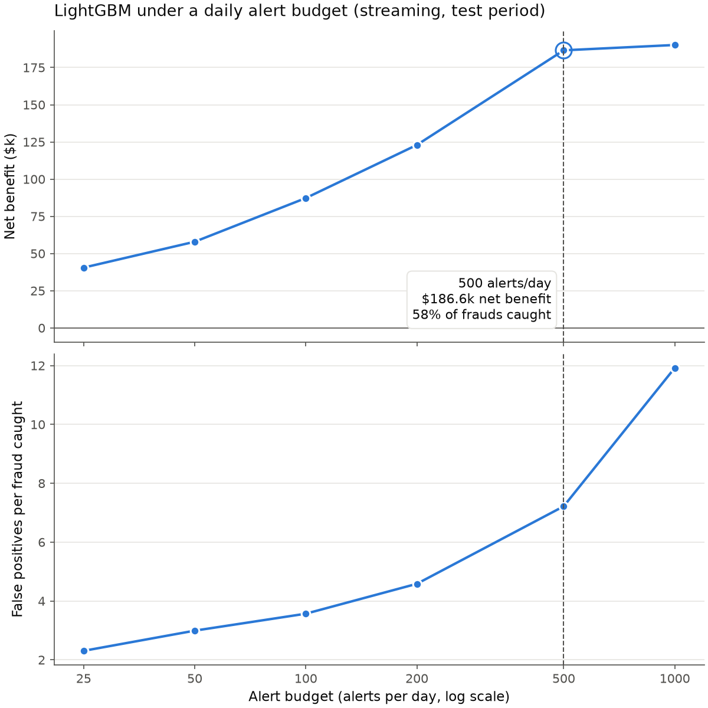
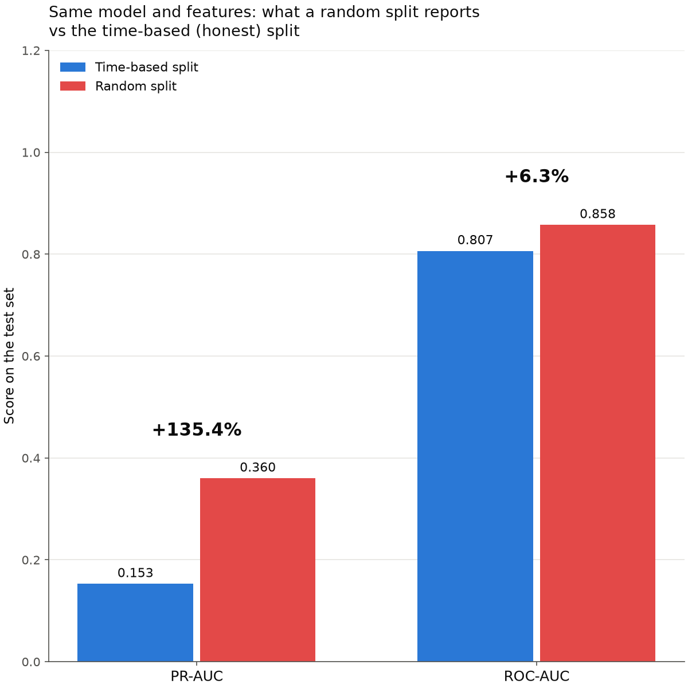
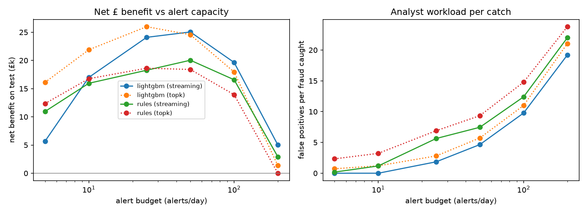

# Fraud Detection under an Alert Budget

A transaction fraud classifier evaluated the way a fraud operations team experiences it: a fixed number of analysts can review **K alerts per day**, and what matters is how much fraud money those K reviews stop, how many innocent customers get bothered along the way, and whether the whole thing pays for itself.

Built with Python, LightGBM, pandas and scikit-learn. Evaluated on the real [IEEE-CIS](https://www.kaggle.com/c/ieee-fraud-detection) fraud dataset, with a bundled synthetic generator so the pipeline also runs without downloading anything.

## Why this project exists

Most fraud-detection notebooks share three problems:

1. **Random train/test splits.** The model gets tested on transactions that happened *before* some of the ones it learned from, and frauds from the same compromised card land on both sides of the split. Scores look excellent and then fall apart in production.
2. **Features that peek at the future.** A common pattern is `df.groupby('card_id')['amount'].transform('mean')` run on the full dataset before splitting. That average includes transactions that hadn't happened yet.
3. **Metrics nobody in operations uses.** ROC-AUC says little to a team that can only review a fixed number of alerts a day.

This repo fixes each one and measures how much the first two mistakes inflate results. On IEEE-CIS, random splitting alone **more than doubled** PR-AUC (+135%), while ROC-AUC moved only 6%.

## Method

**Temporal split.** Train on the first 60% of the timeline, early-stop on the next 20%, test on the final 20%. Every test transaction is later than every training transaction. `--gap-days` can drop the tail of each earlier period to simulate label maturity, since chargebacks take weeks to arrive.

**Leakage-safe features** (`features.py`). All 21 features use only information available when the transaction arrives:

- transaction-level fields: amount, hour, day of week, online flag, merchant category, card BIN
- the card's history *strictly before* this transaction: count, mean and standard deviation of past amounts, this amount relative to the card's normal spend, seconds since the last transaction, share of past online use, first-ever use of this merchant category
- velocity over the windows `[t − 1h, t)`, `[t − 24h, t)` and `[t − 7d, t)`: transaction count, total amount, and number of small (< 5) transactions in the last hour (a card-testing signal)

The windows are computed with `searchsorted` over a composite (card, time) key. That makes them exact and vectorised (about 1 second for 400k rows), and makes the "strictly before" boundary explicit in the code. Labels are never used to build features.

**Model.** LightGBM with early stopping on validation **PR-AUC**. Fraud is rare (3.4% of IEEE-CIS transactions, 0.4% in the synthetic data), so ROC-AUC is dominated by easy negatives, while PR-AUC tracks the top of the ranking, which is the only part an analyst ever sees.

**Evaluation harness** (`evaluate.py`). There are two alerting modes:

- **streaming** (realistic): a score threshold is calibrated on the validation period to produce about K alerts per day. On the test period, transactions arrive in time order, and each one above threshold is alerted until that day's K slots are full.
- **topk** (hindsight upper bound): the K highest-scoring transactions each day. This isn't achievable in real time but is useful as a ceiling.

Reported per budget: precision and recall at budget, fraud amount caught, value capture, false positives per fraud caught, queue utilisation, and **net benefit**:

```
net benefit = fraud amount caught × prevention rate
            − alerts × review cost
            − false positives × customer friction cost
```

**Baseline.** A hand-written rules score (`rules.py`) covering card testing, velocity bursts, unusually large amounts, new merchant category, night-time and online. It is designed around the synthetic data's fraud patterns and is only a meaningful comparison there, so the pipeline scores and reports it on the synthetic data only (see Limitations).

## Results: IEEE-CIS

Test period: 26 April to 1 June 2018 (37 days), 104,637 transactions, 3,562 frauds. Amounts are USD. Assumed costs: $4 per review, $2 friction per false positive.

**At 500 alerts per day:**

| | Streaming (realistic) | Top-K (hindsight ceiling) |
|---|---|---|
| Frauds caught | 2,075 / 3,562 (58.3%) | 2,175 / 3,562 (61.1%) |
| Precision of alerts | 12.2% | 11.8% |
| Value capture (fraud $ stopped) | 53.4% | 55.7% |
| False positives per fraud caught | 7.22 | 7.51 |
| Queue utilisation | 92% | 100% |
| Net benefit over the test period | **$186.6k** | $190.5k |

Ranking metrics on the test period (reference only): ROC-AUC 0.807, PR-AUC 0.153.

**Across alert budgets (streaming):**

| Alerts per day | Fraud caught (recall) | False positives per catch | Net benefit |
|---|---|---|---|
| 25 | 6% | 2.3 | $40.5k |
| 50 | 10% | 3.0 | $57.9k |
| 100 | 18% | 3.6 | $87.3k |
| 200 | 32% | 4.6 | $123.0k |
| **500** | **58%** | **7.2** | **$186.6k** |
| 1,000 | 76% | 11.9 | $190.2k |

Net benefit flattens at about 500 alerts per day: doubling to 1,000 adds only $3.6k while false positives per catch rise from 7.2 to 11.9. Full results, including the hindsight top-K mode, are in `reports/ieee/results.md`.



**Leakage experiment** (`scripts/leakage_experiment.py`). This is a 2×2 design varying split type and feature type, holding everything else fixed (same data, model, hyperparameters and 60/20/20 proportions). Inflation is measured against the honest cell: temporal split with leakage-safe features.

| Mistake | PR-AUC | Recall at top 1% | ROC-AUC |
|---|---|---|---|
| Random split only (same safe features) | **+135.4%** (0.153 → 0.360) | +135.3% | +6.3% |
| Leaky features only (temporal split) | +41.9% | +46.7% | +3.7% |
| Both mistakes | +221.1% | +198.3% | +11.8% |

Random-split cells are averaged over 3 seeds (`--seeds 3`). Precision and recall use the top 1% of each test set, so test sets of different sizes are compared on equal terms.



### What the IEEE-CIS results show

- **ROC-AUC hides the leakage.** A random split moves ROC-AUC by 6% but PR-AUC by 135%. A team watching ROC-AUC would not notice the problem.
- **Both mistakes are serious on real data.** On the synthetic data, leaky features added only 6%; on IEEE-CIS they add 42% on their own, and the two mistakes compound to more than triple PR-AUC.
- **The 135% is probably an underestimate.** The random-split models ran to the 3,000-tree cap (or within 50 trees of it) and were still improving, because they were memorising patterns from the test period they had seen in training. The honest model stopped at 750 trees.
- **A static threshold wastes capacity.** At 500 alerts per day, the threshold calibrated on the validation period was too strict for the test period: queue utilisation was 92%, so on average 39 of the 500 daily slots sat empty, and streaming caught 100 fewer frauds than the hindsight ceiling. The waste is larger at small budgets (70% utilisation at 25 alerts per day). Recalibrating the threshold on a rolling recent window would close part of that gap.
- **The best budget depends on the costs.** On IEEE-CIS, frauds are large relative to the assumed $4 review cost, so extra alerts keep paying for themselves up to about 500 a day. On the synthetic data, with smaller frauds, benefit peaks at 25–50 a day. A team should choose its capacity from a sweep like this under its own cost assumptions, not from a fixed rule.
- **Why PR-AUC is only 0.15.** Leaderboard solutions for this competition used around 400 columns, including the anonymised V and identity features. This project uses 8 raw columns and tests on a genuinely later period. The goal is an honest estimate of future performance, not a leaderboard score.

## Results: synthetic data (seed 42)

The bundled generator (`synth.py`) lets the whole pipeline run without a download. I designed its properties: fraud bursts on compromised cards, a card-testing pattern, and an account-takeover pattern that emerges late in the timeline (drift). These numbers demonstrate the methodology and should not be read as real-world performance.

Test period: May 2025, 86,823 transactions, 320 frauds. Assumed costs: £4 per review, £2 friction per false positive.

**At 25 alerts per day (streaming):**

| | LightGBM | Rules |
|---|---|---|
| Frauds caught | 187 / 320 | 90 / 320 |
| Value capture (£ of fraud stopped) | 68% | 55% |
| False positives per fraud caught | 1.85 | 5.63 |
| Net benefit over the month | **£24.1k** | £18.3k |
| PR-AUC (reference) | 0.616 | 0.280 |

**Leakage experiment** (random-split cells averaged over 3 seeds):

| Mistake | PR-AUC inflation | Recall at top 1% | ROC-AUC |
|---|---|---|---|
| Random split only (same safe features) | **+56.5%** | +48.3% | +2.9% |
| Leaky features only (temporal split) | +5.9% | +3.8% | +0.3% |
| Both mistakes | +59.4% | +50.5% | +2.9% |

### What the synthetic results show

- **Drift is visible.** The model catches 93% of the long-standing card-testing pattern but only 37% of the account-takeover pattern that emerges late in the timeline.
- **A static threshold can backfire.** At 5 alerts per day, the streaming model *lost* to the rules baseline. Its threshold was too strict for May's shifted scores, so it filled only 17% of the queue: every alert was fraud, but most of the slots sat empty.
- **More alerts isn't better.** Net benefit peaks at around 25–50 alerts per day. Beyond that, review costs exceed the extra fraud caught (see `reports/budget_curves.png`).



## Running it

```bash
pip install -e ".[dev]"
pytest -q                                   # 15 tests
python scripts/run_pipeline.py              # synthetic data
python scripts/leakage_experiment.py        # 8 model fits; resumable (cached per cell)
python scripts/make_charts.py               # summary charts from the report files
```

Outputs go to `reports/`: `results.md`, `leakage.md`, `budget_sweep.csv`, `feature_importance.csv` and `budget_curves.png`, plus `budget_summary.png` and `leakage_summary.png` from `make_charts.py`. The charts are drawn only from the report files, so run `make_charts.py` after the other two scripts.

The headline budget, the sweep and the currency symbol default per data source: 25 alerts per day and £ for the synthetic data, 500 alerts per day and $ for IEEE-CIS. `--budget` and `--sweep` override them.

**On IEEE-CIS.** Join the [Kaggle competition](https://www.kaggle.com/c/ieee-fraud-detection/data) to accept its rules, download the data, and unzip it so that `train_transaction.csv` sits in `data/ieee-fraud-detection/`. Then run:

```bash
python scripts/run_pipeline.py --source ieee --data-dir data/ieee-fraud-detection --out reports/ieee
python scripts/leakage_experiment.py --source ieee --data-dir data/ieee-fraud-detection --out reports/ieee --seeds 3
python scripts/make_charts.py --reports-dir reports/ieee --currency "$"
```

The leakage experiment trains 8 models on about 590k rows, at roughly half a minute per fit on a laptop. It caches each cell, so an interrupted run resumes where it stopped.

IEEE-CIS has no card identifier, so the loader builds the community-standard proxy `card1 + addr1 + (day − D1)`. In this dataset, transactions on an account after a confirmed fraud are often also labelled fraud, which makes card-history features unusually strong. The dataset is not included in this repo; Kaggle's competition rules do not allow redistributing it.

## Tests

The most important tests prove the leakage-safety claim directly:

- **Truncating** the dataset at a cutoff leaves every earlier row's features **bit-for-bit identical**.
- **Perturbing** future rows (amounts, categories and labels) changes no earlier row's features.
- A transaction never sees itself or same-timestamp siblings, and window boundaries are exact.
- Velocity features match a brute-force recomputation.
- The deliberately leaky features really do leak, so the experiment's leaky arm is genuine.

The truncation test caught a real bug during development. Window sums originally used one global cumulative sum across all cards, so floating-point rounding from *other* cards' transactions slightly changed a card's standard-deviation feature. Sums now restart per card, and variance is computed on shifted values to avoid cancellation error.

The evaluation tests check that daily budgets are never exceeded, that streaming mode fills slots in arrival order, that threshold calibration hits its target volume, and that the net-benefit arithmetic is correct.

## Assumptions and limitations

- **Cost model.** A review cost of 4 assumes about 10 minutes of analyst time at roughly 24 per hour fully loaded. A friction cost of 2 per false positive is a guess. Both are CLI flags, and conclusions should be checked across a range of values.
- **Rules baseline is synthetic-only.** Its rules target patterns in the synthetic data (small card-testing amounts, an online flag, categories such as crypto and gift cards). IEEE-CIS is entirely card-not-present and its product codes are single letters, so the rules score at random level there (ROC-AUC 0.499 when they were last run on it). `run_pipeline.py` therefore leaves them out of the IEEE-CIS tables and charts. Rules written for IEEE-CIS would be needed for a fair comparison on that data.
- **No card blocking.** Catching the first fraud in a burst would, in reality, block the card and prevent the rest of the burst. Each transaction is scored independently here, which understates the value of early detection.
- **Static threshold.** It is calibrated once on validation. Production systems recalibrate on a rolling recent window, and both datasets show why.
- **Single temporal fold.** The honest estimate comes from one test period. Rolling-origin backtesting over several months would give it a variance estimate.
- **Synthetic data.** It encodes my own assumptions about fraud behaviour, so its numbers demonstrate the method rather than real-world performance.

## Layout

```
src/fraud_alert_budget/
  data.py       schema, validation, synthetic + IEEE-CIS loaders
  synth.py      synthetic generator (bursts, two fraud patterns, drift)
  features.py   leakage-safe features + deliberately leaky ones for the experiment
  split.py      temporal (with optional label gap) and random splits
  model.py      LightGBM with PR-AUC early stopping
  rules.py      rules baseline (synthetic data only)
  evaluate.py   alert-budget harness and business metrics
  pipeline.py   shared glue
scripts/        run_pipeline.py, leakage_experiment.py, make_charts.py
tests/          15 tests
reports/        generated outputs (reports/ieee/ for IEEE-CIS runs)
```
