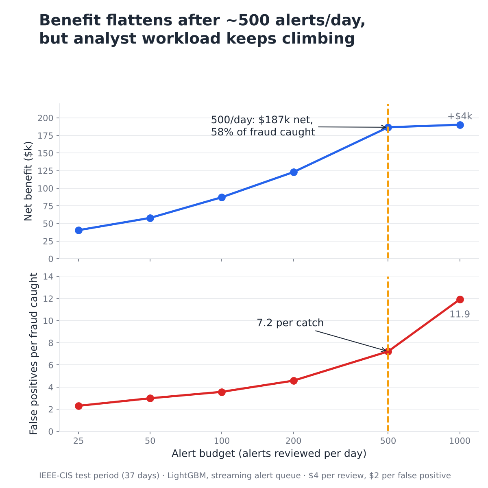

# Results (ieee data)

Test period: 2018-04-26 to 2018-06-01, 104,637 transactions, 3562 frauds.

Cost model: £4 per review, £2 friction per false positive.

## Headline: 100 alerts/day

|                           |   alerts_per_day |   queue_utilisation |   frauds_caught |   frauds_total |   precision_at_budget |   recall_at_budget |   value_capture |   fp_per_fraud_caught |   fraud_gbp_caught |   net_benefit_gbp |
|:--------------------------|-----------------:|--------------------:|----------------:|---------------:|----------------------:|-------------------:|----------------:|----------------------:|-------------------:|------------------:|
| ('lightgbm', 'streaming') |           81.108 |               0.811 |             657 |           3562 |                 0.219 |              0.184 |           0.195 |                 3.568 |           103960   |           87267.7 |
| ('lightgbm', 'topk')      |          100     |               1     |             756 |           3562 |                 0.204 |              0.212 |           0.216 |                 3.894 |           115263   |           94574.7 |
| ('rules', 'streaming')    |           88.541 |               0.885 |             183 |           3562 |                 0.056 |              0.051 |           0.117 |                16.902 |            62326.7 |           43036.7 |
| ('rules', 'topk')         |          100     |               1     |             194 |           3562 |                 0.052 |              0.054 |           0.138 |                18.072 |            73799.4 |           51987.4 |

## Ranking metrics on test (reference only)

|          |   roc_auc |   pr_auc |
|:---------|----------:|---------:|
| lightgbm |    0.8065 |   0.1531 |
| rules    |    0.4987 |   0.0363 |

## Budget sweep (streaming mode)

|   k_per_day |   ('net_benefit_gbp', 'lightgbm') |   ('net_benefit_gbp', 'rules') |   ('fp_per_fraud_caught', 'lightgbm') |   ('fp_per_fraud_caught', 'rules') |   ('recall_at_budget', 'lightgbm') |   ('recall_at_budget', 'rules') |
|------------:|----------------------------------:|-------------------------------:|--------------------------------------:|-----------------------------------:|-----------------------------------:|--------------------------------:|
|          25 |                           40530.5 |                         952.67 |                                  2.31 |                              19.31 |                               0.06 |                            0.01 |
|          50 |                           57918   |                       30948.7  |                                  2.99 |                              16.98 |                               0.1  |                            0.02 |
|         100 |                           87267.8 |                       43036.8  |                                  3.57 |                              16.9  |                               0.18 |                            0.05 |
|         200 |                          122964   |                       33303.4  |                                  4.58 |                              22.59 |                               0.32 |                            0.08 |
|         500 |                          186573   |                       97166.4  |                                  7.22 |                              23.11 |                               0.58 |                            0.2  |
|        1000 |                          190162   |                       50341    |                                 11.92 |                              28.75 |                               0.76 |                            0.32 |

## Top features (gain share)

| feature             |     gain |   share |
|:--------------------|---------:|--------:|
| category            | 105490   |   0.213 |
| card_bin            |  89018   |   0.18  |
| log_amount          |  66399.3 |   0.134 |
| secs_since_last     |  36314.4 |   0.073 |
| sum_7d              |  31947.9 |   0.065 |
| card_mean_amt_prior |  30315.8 |   0.061 |
| card_std_amt_prior  |  27527.3 |   0.056 |
| hour                |  23393.6 |   0.047 |
| card_n_prior        |  15253   |   0.031 |
| amt_to_prior_mean   |  14093   |   0.028 |

